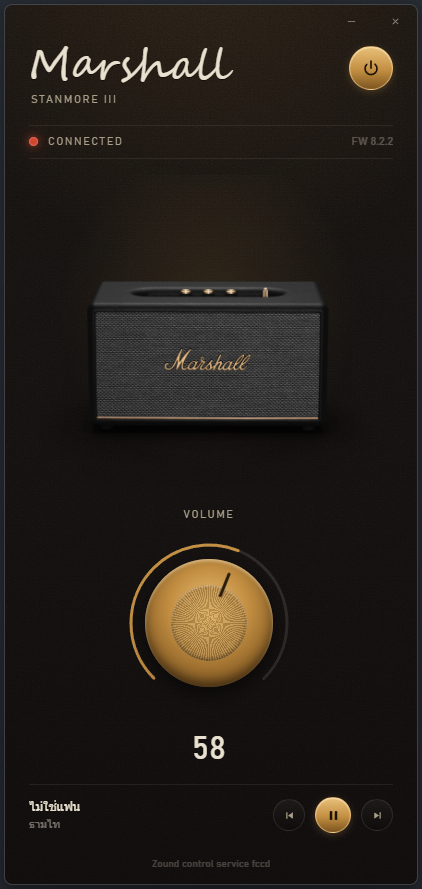

# Marshall Controller

A Windows desktop app to control **Marshall / Zound Bluetooth speakers** over Bluetooth Low Energy.
Built for a **Marshall Stanmore III**, but model-agnostic — other Marshall speakers work too, the way
the official mobile app does.

Volume, tone, input source, night mode, transport controls, per-model speaker artwork and live
now-playing info, in a portrait amp-styled window.

<p align="center">
  
</p>

> Reverse-engineered from the official Marshall Bluetooth Android app (`com.zoundindustries.marshallbt`
> v3.9.2) by static analysis, to control a speaker I own. No code from that app is included. Not
> affiliated with or endorsed by Marshall Amplification or Zound Industries.

---

## Features

- **Volume** rotary knob shown 0–100%, with one-tap **Calibrate** so the number matches Windows exactly
- **EQ** — Bass & Treble faders on models that expose them, or one-tap genre **presets** on models that don't (e.g. Emberton II); the app shows whichever the speaker supports
- **Source** — BT / RCA / AUX / HDMI (only the inputs the speaker actually exposes are enabled)
- **Night mode** — the speaker's dynamic-range limiter (tames loud peaks for quiet-hours listening)
- **Now playing** — title / artist with transport controls, from the Windows media session
- **Per-model artwork** from Marshall's image CDN, with **multi-model** support via a ~28-model catalog
- Amp-styled UI with GSAP motion (honors `prefers-reduced-motion`)

---

## Architecture

Three cooperating processes — because writing to the speaker's LE control characteristics on Windows
needs a **bonded** link that Electron's own (and Web Bluetooth's) stack can't establish:

```
 Electron                                    Python sidecar
┌──────────────────────────┐   stdio JSON   ┌────────────────────────┐
│ main.js ⇄ renderer (UI)  │ ◀────────────▶ │ ble_bridge.py (Bleak)  │
└──────────────────────────┘                └───────────┬────────────┘
                                                         │
                               BLE  ·  Core Audio (pycaw)  ·  SMTC (winrt)
                                                         ▼
                                                🔊 Marshall speaker
```

- **Electron main** (`src/main.js`) — owns the window, spawns the Python bridge, relays IPC ⇄ stdio,
  and injects the CDN auth header for speaker images.
- **Renderer** (`src/renderer/`) — the UI. `ble-protocol.js` is the protocol codec (`window.BLE`);
  `renderer.js` drives the panel and the animations.
- **BLE bridge** (`src/bridge/ble_bridge.py`) — the radio. **Bleak** (WinRT) connects/bonds and does
  the GATT reads/writes/notifications; **pycaw** reads the speaker's real volume % (for Calibrate);
  **winrt** reads the Windows media session for now-playing.

**Why a Python sidecar?** Writing the LE control characteristics requires an **encrypted/bonded**
link. Web Bluetooth and Electron's renderer BLE can't pair/bond on Windows — every write failed with
*"GATT Error: Not paired"*. Bleak plus an OS-level bond does work (see [Setup](#setup) step 3).

---

## Project structure

```
.
├── README.md
├── package.json
├── assets/
│   ├── icon.ico             # app icon (Windows taskbar / alt-tab)
│   └── icon.png
├── docs/
│   ├── PROTOCOL.md          # full reverse-engineered BLE spec
│   └── screenshot.png
└── src/
    ├── main.js              # Electron main process
    ├── preload.cjs          # contextBridge: window.ble + window.win
    ├── bridge/
    │   ├── ble_bridge.py    # Python Bleak engine (BLE + audio + media)
    │   └── requirements.txt
    └── renderer/
        ├── index.html       # UI markup (CSP-locked)
        ├── renderer.js      # UI logic + GSAP animations
        ├── ble-protocol.js  # protocol codec (window.BLE)
        ├── input.css        # Tailwind v4 source
        ├── styles.css       # built CSS (bun run css)
        └── vendor/
            └── gsap.min.js  # vendored (renderer CSP is script-src 'self')
```

---

## Prerequisites

- **Windows 10 / 11** with Bluetooth LE
- [**Bun**](https://bun.com) — package manager + task runner
- **Python 3.9+** on `PATH`
- A Marshall / Zound BLE speaker you own

## Setup

**1 — JS dependencies + build the stylesheet**
```powershell
bun install
bun run css
```

**2 — Python dependencies**
```powershell
pip install -r src/bridge/requirements.txt
```

**3 — Pair the speaker in Windows first (required)**

The LE control link needs an OS bond. On Windows that key is derived (via CTKD) from the normal
Classic-Bluetooth audio pairing:

1. Settings → Bluetooth → **Add device** → pair **"STANMORE III"** (the ordinary audio device).
2. Once it pairs, a **"STANMORE III [LE]"** entry also shows as paired — that LE bond is what the app
   connects over.

Skip this and the app can still scan and connect, but every control write fails with *Not paired*.

**4 — Run**
```powershell
bun run start
```

---

## Usage

- **⏻ Power** (top-right) → scans → pick your speaker. The LED lights and the panel powers on.
- **Volume** — drag around the knob, scroll it, or use arrow keys. The readout is 0–100%.
  - **Calibrate %** sweeps the speaker through every step, reads the true Windows level at each, and
    stores a per-device table so the shown % matches Windows. Keep audio paused during the sweep.
- **Tone** — Bass / Treble faders (on models with manual EQ).
- **Presets** — one-tap genre EQ (on models that use presets instead, e.g. Emberton II).
- **Source** — pick the input (unsupported inputs are dimmed).
- **Night mode** — toggle.
- **Now playing** — whatever is playing on Windows, with transport controls.
- **System tray** — the ✕ button hides the window to the tray and keeps the speaker connected in the
  background; click the tray icon to bring it back, or right-click → **Quit** to exit.

### Other speaker models

The app identifies the speaker from its advertised name / model and adapts: it enables only the
controls that model exposes and loads that model's artwork. The model→image map lives in
`src/renderer/ble-protocol.js` (`MODEL_CODENAME`) and covers ~28 Marshall models
(Stanmore / Acton / Woburn III, Emberton II, Middleton, Willen, …).

---

## Build a Windows .exe

```powershell
bun run dist     # portable .exe + installer -> dist/
# or
bun run pack     # unpacked app folder (faster, for a quick test)
```

`bun run dist` writes two files to `dist/`:

- **MarshallController-portable.exe** — single file, no install; just double-click.
- **MarshallController-Setup.exe** — an installer (pick a folder, adds a Start-menu shortcut).

Builds are unsigned, so Windows SmartScreen warns on first launch (*More info → Run anyway*).

> **The target machine still needs Python + the bridge deps.** The packaged app spawns the system
> `python` with the bundled bridge (shipped under the app's resources), so Python and a
> `pip install -r` of the bridge requirements must be present. Making it fully self-contained
> (bundling the bridge as its own `.exe` with PyInstaller, so no Python is needed) is a possible next step.

---

## The reverse-engineered logic

Full detail in **[docs/PROTOCOL.md](docs/PROTOCOL.md)**. The essentials:

**GATT.** Modern Zound speakers expose a custom service `0000fccd-…`. Each characteristic has a custom
128-bit UUID, with a legacy 16-bit alias as fallback:

```
custom(XXXX) = 0000XXXX-1337-1dea-feed-c0ffee70c0de
legacy(XXXX) = 0000XXXX-0000-1000-8000-00805f9b34fb
```

**Characteristics this app uses** (`XXXX` = the custom short id):

| Function      | id     | Payload |
|---------------|--------|---------|
| Volume        | `0007` | 1 byte — step `0..limit` (byte ≥ 0x80 = invalid) |
| Volume limit  | `0008` | 1 byte — max step (31 on this unit) |
| Graphical EQ  | `000f` | 5 bytes `[bass, low, mid, upper, treble]`, each 0–10 (`0xFF` = band absent) |
| EQ presets    | `0017` | assign preset to a step — `[0x01, step, preset]` (FLAT 0 · ROCK 2 · HIPHOP 5 · ELECTRONIC 6 · JAZZ 7) |
| Audio source  | `001b` | 1 byte code — BT 0 · AUX 2 · RCA 3 · HDMI 5 … |
| Night mode    | `001f` | 1 byte — 0 / 1 |
| Audio control | `0009` | 1 byte — 0 pause · 1 play · 2 prev · 3 next |
| Model name    | `2a24` | UTF-8 |
| Firmware      | `2a26` | UTF-8 |
| Battery       | `2a19` | uint8 % |

> **EQ differs per model, and the app feature-detects it.** Stanmore III exposes `GRAPHICAL_EQ`
> (`07 FF FF FF 07` — only Bass + Treble; the three middle bands are absent) but **not** the preset
> characteristic `0017`. A portable like Emberton II is the opposite — no manual bass/treble, only genre
> **presets** via `0017`. On connect the bridge reports which characteristics the speaker actually has,
> and the UI dims any control the model lacks — so the **Tone** and **Presets** panels each light up only
> on the models that support them. No per-model code is needed.

**Bonding (Windows).** Control writes need an encrypted link; Windows derives the LE key from the
Classic audio pairing (CTKD) — which is why you pair the audio device first. Bleak then
`connect()` + `pair()` succeeds.

**Volume %.** The speaker's volume is a **step** `0..limit`, not a percentage, and the firmware maps
steps to loudness on a **non-linear AVRCP curve** — so `step / limit × 100` does *not* match the %
Windows shows. **Calibrate** walks every step, reads the real level from the speaker's Core Audio
endpoint (pycaw), and builds a lookup table so the UI agrees with Windows.

**Now playing** comes from the **Windows media session** (SMTC), not the speaker: the BLE now-playing
characteristic only carries title/artist, whereas SMTC also gives play state and working transport
controls for whatever app is playing.

**Artwork** is fetched from Marshall's CDN:

```
https://app-images.marshall.software/marshall-bt/android/prod/{codename}_{color}_hero_1-1_xxxhdpi.webp
```

It requires the header `marshall-mobile-app-version: 3.9.2` (injected in `main.js`, since `` can't
set request headers). `codename` is resolved from the model — e.g. Stanmore III = `tylerM`.

---

## Development notes

- **CSS** — `bun run css` builds `src/renderer/input.css` → `styles.css` (Tailwind v4; `@source` is
  scoped to the renderer folder so `vendor/` is skipped). `bun run css:watch` while editing.
- **Animations** — GSAP, vendored locally because the renderer CSP is `script-src 'self'`. Every
  animation is gated by the `ANIM` flag in `renderer.js`, which honors `prefers-reduced-motion`.
- **Debugging** — `main.js` mirrors the renderer console and the Python bridge's stderr into
  `debug.log` at the repo root; there's also an in-app **Log** panel.

## Legal

For interoperability with hardware I own, via static analysis of the official app. "Marshall" and the
model names are trademarks of their respective owners; this project is not affiliated with or endorsed
by Marshall Amplification or Zound Industries.
